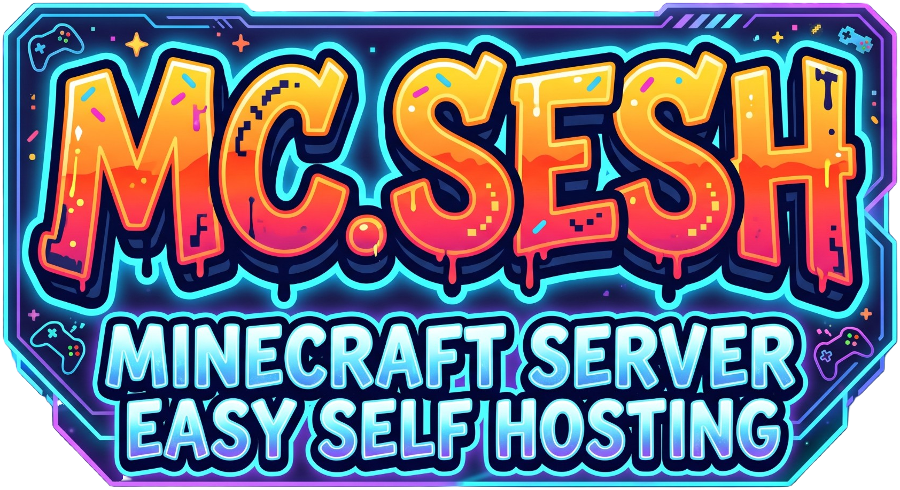
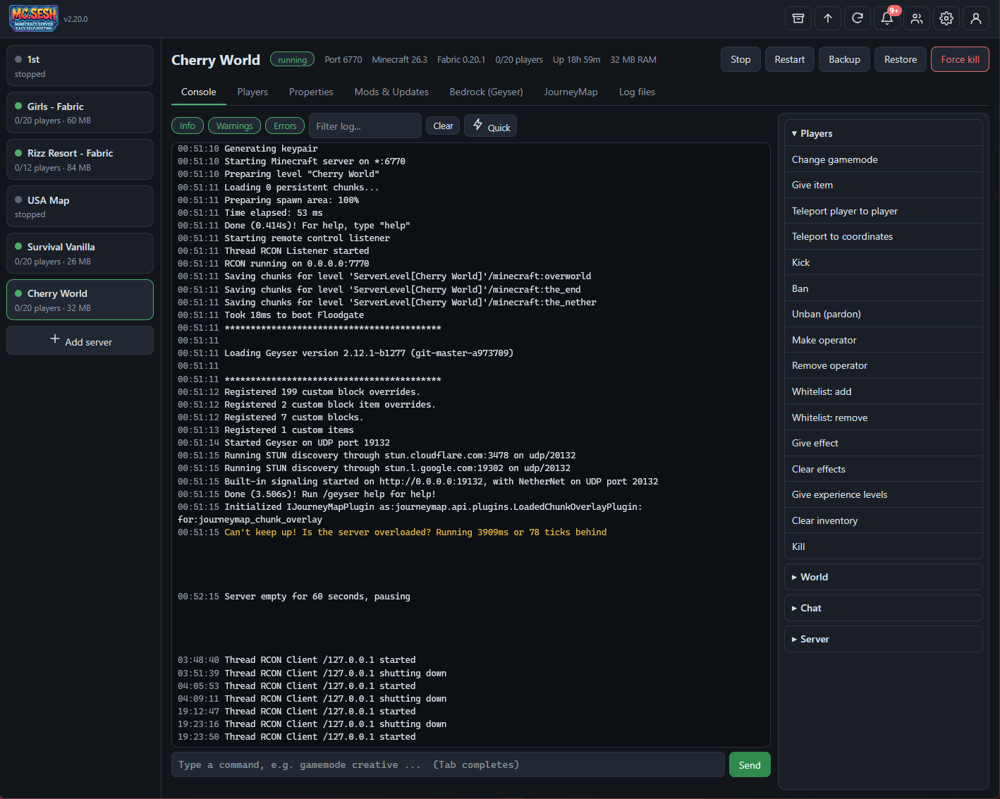
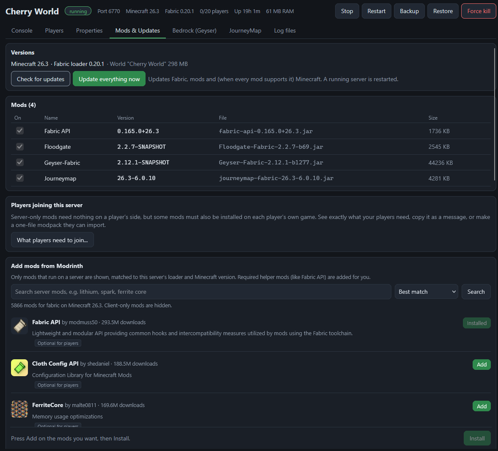
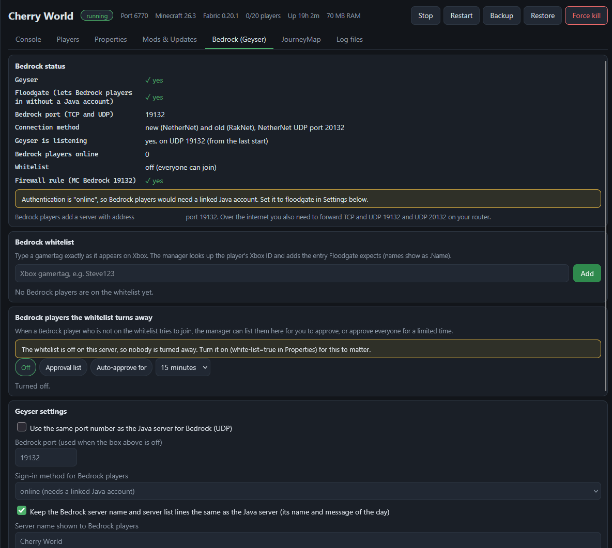
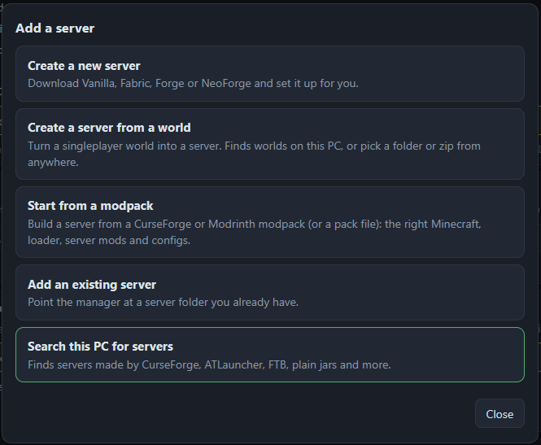
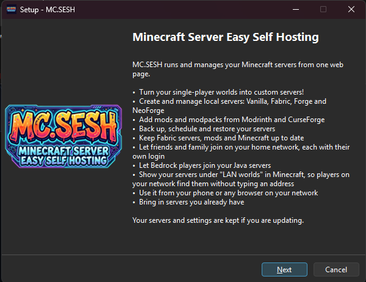

<p align="center"></p>

# MC.SESH

**Minecraft Server Easy Self Hosting.** Run and manage Minecraft: Java Edition servers on your own Windows PC from one web page, on that PC, on your phone, or on any device in your home.

> **Turn your single-player worlds into custom servers.**

MC.SESH is a small program with no dependencies to install. It brings its own Java.

## What it does

- Create and manage local servers: **Vanilla, Fabric, Forge and NeoForge**
- Add mods and modpacks from **Modrinth** and **CurseForge**
- Back up, schedule and restore your servers
- Keep Fabric servers, mods and Minecraft up to date
- Let friends and family join on your home network, each with their own login and permission level
- Let **Bedrock** players join your Java servers (Geyser and Floodgate)
- Show your servers under **LAN worlds** in Minecraft, so players on your network find them without typing an address
- A live **JourneyMap** tab: waypoints, teleporting and map settings
- Automatic restarts by time or when a server is idle, with a countdown warning in chat
- Players tab with quick commands, a console, log files, properties editor and more
- Works from a phone and can be added to the home screen like an app
- Bring in servers and single-player worlds you already have

## Screenshots

<p align="center"></p>

| | |
|---|---|
|  |  |
|  |  |

## Install (Windows 10 or 11, 64-bit)

**Option 1: the zip (recommended).** Download `MC.SESH-<version>-win64.zip` from the [Releases](../../releases) page, unzip **the whole folder**, then double-click `Install.bat`. A setup wizard opens in your browser: pick folders, create the owner account, choose your defaults and whether MC.SESH starts with Windows. When it finishes, MC.SESH opens in the same tab. No browser? `Install-Text.bat` does the same in a plain text window. You can also just run `Start.bat` to use it without installing.

**Option 2: the installer.** `MC.SESH-Setup-<version>.exe` is a classic setup wizard. It is **not code-signed yet**, so Windows SmartScreen may warn about it, and Windows with *Smart App Control* turned on can block it. If that happens, use the zip.

You do **not** need to install Java. To let other devices open MC.SESH, allow it through Windows Firewall when the setup offers to.

## Use it from your phone

Once it is running, open `http://<this-PC's-address>:8585` in your phone's browser while on the same Wi-Fi. The setup shows the address. To keep the address from changing, give this PC a DHCP reservation in your router.

## CurseForge

Browsing CurseForge modpacks needs your own free API key from <https://console.curseforge.com/>. Add it in the setup or later under Settings. Modrinth works without a key.

## Build from source

Needs a JDK 17 or newer with `jlink` (Eclipse Temurin 25 is what the releases use), and [Inno Setup 6](https://jrsoftware.org/isinfo.php) for the installer.

```powershell
powershell -ExecutionPolicy Bypass -File build-dist.ps1 -Version 2.20.1            # builds dist\MC.SESH and the zip
powershell -ExecutionPolicy Bypass -File build-installer.ps1 -Version 2.20.1       # also builds the Inno installer
powershell -ExecutionPolicy Bypass -File quick-deploy.ps1                          # fast compile and JavaScript syntax check
```

The manager is a single Java program with no external libraries. Source is in `src/`, the web interface in `web/`, packaging in `packaging/` and `installer/`.

## Licence

MC.SESH is **source-available** under the [PolyForm Noncommercial License 1.0.0](LICENSE). In short: you may read it, run it and change it for personal, hobby, educational and charitable use at no cost. Selling it, or using it for a commercial purpose (for example, running paid servers with it), needs a separate licence from the author. To ask about one, open an issue titled **Commercial licence**.

The MC.SESH name, logo and artwork are **not** covered by that licence. See [CREDITS.md](CREDITS.md).

## Not affiliated with Mojang or Microsoft

MC.SESH is an unofficial tool. It is not approved by or associated with Mojang Studios or Microsoft. Minecraft is a trademark of Mojang Studios.

Brought to you by **Steeze Cake**.
